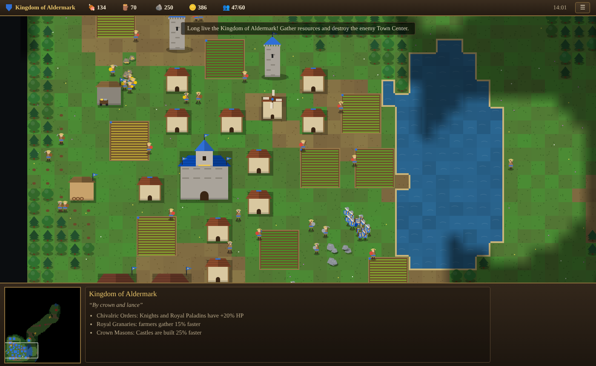
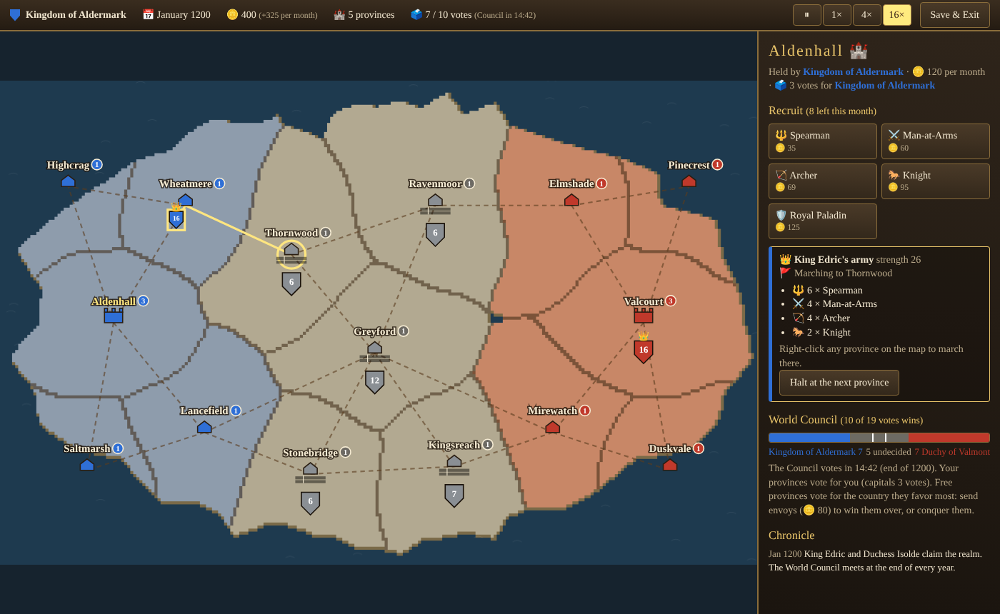

# Empires: Age of Crowns

A medieval strategy game for the PC, played in the browser: real-time battles and base building
in the spirit of Age of Empires, plus a real-time world map campaign in the spirit of Medieval:
Total War, alone or with friends. Every player has a **leader**; if the leader dies, that player is out.





## Play

**Single player** needs nothing installed: open `index.html` in Chrome, Edge or Firefox.

**Multiplayer** (and single player) through the game server:

```sh
npm install
npm start            # serves http://localhost:8080
```

1. Both players open the game (`http://localhost:8080` on the host PC, `http://<host-ip>:8080`
   from another PC on the same network).
2. Choose an empire, open the **Multiplayer** tab and press **Create Room**.
3. Other players enter the four-letter room code and press **Join Room**.
4. The host can press **Add AI Player** to fill seats with computer opponents or allies and set
   their difficulty. Everyone picks an empire and a team: players on the same team are allies
   and share vision. Up to 4 players, humans and AI in any mix (1v1, 2v2, 1v1v1v1, two friends
   against the computer, ...).
5. The host presses **Start Battle**. A player who leaves forfeits; their team fights on.

**Multiplayer world campaign** (co-op or versus):

1. Choose an empire, open the **Multiplayer** tab, pick how long a game year lasts (4 hours by
   default) and press **Create World**. The top bar shows the world code.
2. Friends enter the code and press **Join**. The empire you picked decides your side: pick the
   same empire as a friend to rule that country together (shared treasury and armies), or the
   other empire to fight each other. A country with nobody online is ruled by the computer.
3. When a battle starts, anyone on either side can choose to fight it in real time; everyone
   online on those sides joins the battle. Otherwise it is auto-resolved after 30 seconds.
4. Leave whenever you like and come back later with the same code and name. The world clock
   only runs while someone is playing, and worlds are saved in `data/worlds/` on the server, so
   they survive a restart.

To play over the internet, forward port 8080 on the host's router or deploy the server
to any Node host (set `PORT` if needed). The server runs the authoritative simulation,
so a player can only command their own units.

## Modes

- **World Campaign:** rule a country on a real-time world map. The calendar runs (pause it or
  speed it up in single player); your provinces pay gold every month. Recruit troops, then
  right-click any province to march an army there along the roads. When armies meet you choose to
  fight the battle in real time or auto-resolve it. Your leader commands your main army: if your
  leader falls, your reign ends. Progress is saved in the browser.
- **World Council:** at the end of every game year the provinces vote for a World Leader. Your
  provinces vote for you (capitals have 3 votes, other provinces 1, 19 in all). The five free
  provinces in the middle vote for the country they favor most: send envoys with gifts to win
  them over, or conquer them (which makes the other free lords trust you less). 10 votes elect
  you World Leader and win the game. A year lasts 15 minutes, 1 hour or 4 hours of real time.
- **Skirmish:** a full real-time game (economy, buildings, army) against the computer.
- **Multiplayer:** the same with friends and AI players, up to 4 players in teams (see above).

## Empires

| Empire | Leader | Strengths | Weaknesses | Unique unit |
| --- | --- | --- | --- | --- |
| **Kingdom of Aldermark** (blue) | King Edric | Knights and Paladins +20% HP · farmers +15% · Castles built 25% faster | Archers cost 25% more · Spearmen and Men-at-Arms 10% slower | **Royal Paladin**: elite heavy cavalry |
| **Duchy of Valmont** (red) | Duchess Isolde | Lumberjacks +15% · Towers and Castles cost 20% less stone · archers +1 range | Knights cost 25% more · farmers 10% slower | **Longbowman**: very long range archer |

New empires are a single entry in `EMPIRES` in [`js/data.js`](js/data.js) (plus a unit in `UNITS`
if it has a unique unit).

## How to play

- **Start:** a Town Center, two men and two women villagers, and your leader.
- **Economy:** villagers gather food (berries, farms), wood (trees), stone and gold, and carry it
  to a Town Center or a Mill / Lumber Camp / Mining Camp. Houses raise your population cap.
- **Army:** Barracks (Spearman, Man-at-Arms), Archery Range (Archer), Stable (Knight) and the
  Castle (your empire's unique unit). Spearmen counter cavalry, cavalry counters archers,
  archers counter infantry. Watch Towers, Town Centers and Castles shoot arrows.
- **Victory:** kill the enemy leader (or destroy everything they have). When a leader dies, that
  player's realm crumbles. In team games the last team standing wins.

### Controls

| Input | Action |
| --- | --- |
| Left click / drag | Select (double-click selects all of a type on screen) |
| Right click | Move, gather, build/repair, attack, or set a rally point |
| Arrow keys, screen edges, minimap | Scroll · mouse wheel zooms |
| `Q W E R` / `A S D F` / `Z X C V` | Command buttons (build menu, train units) |
| `Shift` while placing | Place several buildings |
| `H` / `L` / `.` | Select Town Center / leader / next idle villager |
| `Ctrl+1-9`, `1-9` | Assign / select control group (double-tap to jump) |
| `Del`, `Esc`, `P` | Delete selection, cancel, pause / menu |
| `Enter` | Chat (multiplayer) |

## Development

Plain JavaScript and Canvas, no build step. The simulation (`js/game.js`, `js/ai.js`, …) has no
DOM access, so the server and the tests load the same files with Node's `vm` module
(`server/sim.js`).

```sh
npm test   # maps, empires, leaders, economy, AI games, world rules, multiplayer rooms and worlds
```

| File | Purpose |
| --- | --- |
| `js/data.js` | Units, buildings, empires, balance |
| `js/map.js` | Procedural map with 4-fold symmetry (4 start positions) |
| `js/pathfinding.js` | A* on the tile grid |
| `js/game.js` | Simulation and player commands |
| `js/ai.js` | Computer opponent (base building and battle mode) |
| `js/campaign.js` | World map rules: calendar, provinces, marching armies, World Council, auto-resolve, computer rulers |
| `js/campaign-ui.js` | World map screen |
| `js/render.js` | Procedural canvas art, fog of war, minimap |
| `js/ui.js` | HUD, selection, input |
| `js/net.js` | Multiplayer snapshots and client |
| `server/index.js` | Static file server, multiplayer battle rooms and multiplayer worlds |
